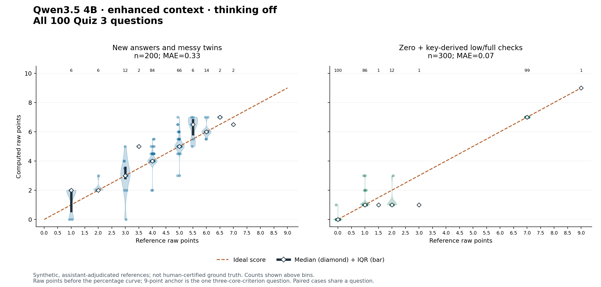

# Standard local grading: Qwen3.5 4B

New local packages use **Qwen3.5 4B Q4_K_M**, profile **`qwen35-context-off-v1`**, with thinking disabled. The model classifies evidence for each point; the shared scorer computes the mark. It handles one question at a time and always scores a complete set of judgments, including uncertain judgments. Technical failures remain visible failures and use the existing same-model retries; they never become invented zero-credit decisions.

Select `gradingBackend: "local"` and `localModel: "qwen3.5-4b"` in course defaults or an assignment. Existing explicit GenAI choices stay in effect. An explicit `qwen2.5-3b` retains the legacy implementation. Unknown names refuse; there is no silent model substitution. New public course templates use Qwen3.5. Existing frozen artifacts do not change.

## What the main-branch investigation contributed

The Qwen2.5 work exposed copied JSON examples, missing optional decisions, greedy JSON extraction, and unsupported penalty explanations. Its line format and missing-ID repair remain in the legacy profile. The shared balanced-object parser, quoted-penalty checks, self-correction rules, rejection of a false-claim explanation that just restates its quote, rounding, and retry ladder remain active. The new profile uses constrained JSON without a filled verdict example. Its grammar requires every criterion, and the parser independently rejects missing decisions or truncated output.

Earlier recommendations favoring Qwen2.5 were predominantly **band-mode** results. They do not establish points-mode quality. Likewise, the new points study does not establish accuracy for the Qwen3.5 band compatibility path. Keep a legacy pin for an already qualified band assignment or evaluate the new model separately.

The evidence-grounding filter remains **off by default**. In the earlier experiment it removed many false credits but also some earned credits; that is not a free accuracy improvement under INV-GRADE-11. A copied quote can be grounded but semantically irrelevant, so exact quote matching does not solve every error.

## Evidence and limits

The integration replays **500 frozen synthetic answers across 100 questions**, preserving every request payload, raw-point total and final score from the evaluated adapter. This is a regression check, not 500 new model calls. Inputs include fillers, repetitions, broken punctuation and harmless transcription errors.

The primary set contains **200 newly phrased intermediate answers**, a clean/messy pair for each question. References were assistant-authored before inference, with instructor-approved credit policies; they are **not independently certified human ground truth**.

| Primary-set measure | Result |
|---|---:|
| Mean absolute error, raw points | 0.3275 |
| Question-cluster bootstrap 95% interval | 0.2275–0.4301 |
| Median / 90th percentile / maximum absolute error | 0 / 1 / 3 |
| Exact scores | 131/200 |
| Undergraded / overgraded answers | 17 / 52 |
| Mean lost / excess credit per answer | 0.095 / 0.2325 points |
| Pearson correlation | 0.862 |

The other cases are 100 low anchors, 100 full-key anchors and 100 zero controls. Full-key anchors all scored correctly; **99/100 zero controls** did. These easy cases inflate aggregate accuracy. Across 100 clean/messy pairs, 79 scores matched, 7 decreased and 14 increased; the maximum pair change was 4 points. A posthoc generous interpretation of overlapping criteria raises primary MAE to **0.4025**, with **49 under / 38 over**. Report this sensitivity alongside the primary result.

Known failures remain: a meaningful short paraphrase received no credit, while its messy twin received credit; an admission of not knowing an answer was confused with a relevant admission of not knowing a stakeholder's workflow. The latter earned one raw point and 70% under that course's curve. No unmeasured heuristic was introduced to hide either case. Percentage calibration cannot repair such semantic errors.

On a matched 42-answer subset, Qwen3.5 4B MAE was 0.774, Nemotron 3 Nano 4B 1.25, and locally run Qwen3.6 27B 0.417 raw points. Under/over counts were 18/4, 4/21 and 11/3 respectively. GPU means were 7.97, 7.36 and 38.89 seconds per answer. The 27B run is a local quantized proxy for the former GenAI model, **not a call to or measurement of Purdue's service**. Different case mixes explain why those MAEs differ from the expanded study.

The [aggregate results](local-grading/expanded-aggregate.json) and plot below preserve the raw-point view; the white diamonds mark medians and dark bars mark IQRs.



## Memory, runtime and setup

Use **4 CPU / 6 GB RAM, 40-minute timeout**, Ubuntu 22.04 or newer. The pinned standalone llama.cpp runtime is `b10717`; model revision and SHA256 hashes live in `autograder/source/runtime-manifest.json`. Image setup verifies downloaded artifacts and an actual model reply, and compiles the pinned source if the prebuilt executable cannot run. Grading uses loopback HTTP only and needs no external network.

Whisper is released before the grading model starts. Native Linux ARM CPU testing under a 6 GB limit peaked at **3.55 GB** and took **17.8 minutes for five calls**, including a 924-word stress answer. That leaves about 2.45 GB measured headroom. This excludes transcription and is **not native Gradescope x86 timing**. An Ubuntu 22.04 x86 setup smoke test succeeded under emulation, peaking at 4.07 GB; emulated inference was too slow to treat as a timing estimate. Actual Gradescope timing remains a deployment check. The integrated adapter also passed a fresh offline Ubuntu 24 ARM CPU smoke on a short generic prompt: 39.5 seconds, 3.48 GB peak, zero OOM. This is an execution check, not a five-question timing estimate.

The 4096-token window reserves 900 output tokens plus 64 safety tokens. The adapter measures the fully rendered prompt and refuses overflow without silently dropping student words. Prompt caching is disabled, thinking is explicitly disabled in both server and request, and one server slot bounds concurrent memory. More questions cost time, not simultaneous contexts. Long inputs or much larger rubrics need separate resource qualification.

## Authoring future banks

Existing banks work through a generic key/reference/evidence fallback. For stronger context, each question may include:

```json
"gradingContext": {
  "courseExplanation": "A concise teacher-checked explanation of the relevant reasoning.",
  "pointDecisions": [
    {"id":"R1", "meaning":"The complete meaning of this required point.",
     "sufficientExample":"One sufficient explanation; equivalent paraphrases count."},
    {"id":"O1", "meaning":"The meaning of a distinct extension point.",
     "sufficientExample":"One sufficient extension."}
  ],
  "systemGuidance": ["An instructor-approved partial-credit boundary, if needed."]
}
```

The IDs must exactly match `keyPoints` (`R1…`) and `bonusPoints` (`O1…`) in order. This is trusted instructor metadata, never student-provided text. Use a strong authoring model to draft explanations and sufficient meanings, then verify them against course sources. Avoid overlapping criteria in new keys. For existing overlapping keys, one explanation may activate multiple listed criteria when it conveys each meaning. A concrete example receives listed or novel credit, never both for the same example. The software's shared scoring policy controls weights and the curve.

Freeze synthetic references before evaluating: include every point alone, partial credit, combinations across raw score levels, optional-only answers, contradictions, self-corrections, novel examples, nonanswers, prompt injection, and clean/messy pairs. Hold out questions and phrasing. Report undergrading separately from overgrading; do not accept reduced MAE as an improvement if it increases lost earned credit. More context and generic fallback behavior are not automatically certified by the existing study.

## Versioned alternatives and reproduction

Declare a named alternative in an assignment's `regrades` map, preserving the original `bank` and grading settings:

```json
"regrades": {
  "qwen35-context-off-v1": {
    "id":"qwen35-context-off-v1", "gradingBackend":"local",
    "localModel":"qwen3.5-4b", "bank":"banks/quiz.enhanced-v1.json",
    "note":"Enhanced key and context; unchanged student questions and scale."
  }
}
```

Build with `node tools/build-autograder.js courses/<id>/course.json --zip --assignment <aid> --regrade qwen35-context-off-v1`. The builder rejects changes to bank identity, question order, prompts and non-grading question fields. It includes only the selected bank/assignment, omits unused GenAI credentials, and records code, bank, course and runtime provenance in `local-profile.json`. Keep the resulting artifact immutable once used; freeze that variant and use a new variant ID for subsequent changes. Uploading/regrading is a separate instructor action, applied to the whole cohort.

Run `npm run test:local` for public synthetic contract tests. Use the integrated evaluator with private files remaining inside their course:

```bash
ORALSCALE_LOCAL_URL=http://127.0.0.1:8941 python3 tools/eval/local-profile-eval.py \
  --bank courses/<id>/banks/quiz.enhanced-v1.json --course courses/<id>/course.json \
  --assignment <aid> --cases courses/<id>/local-grading/frozen-cases.json \
  --out courses/<id>/local-grading/run-v1.jsonl
```

Each case has `id`, `questionId`, `transcript` and a preassigned raw-point `gold` (or complete `reference` decisions). Outputs checkpoint after each answer and refuse to overwrite an existing run. `--replay <results.jsonl> …` instead validates frozen request and score parity without inference. The older `points-bench.py` prompt-ablation harness explicitly selects Qwen2.5 because those variants target its line prompt.

## DEBUG packages for instructor uploads

To test a student's signed submission under the instructor's own Gradescope account,
add `--debug-identity` to the same package command. It requires `--zip` and an explicit
`--assignment`; it writes a separate `-DEBUG-identity-flag-only.zip` and preserves the
standard artifact. Use the same named regrade alternative for both builds.

The DEBUG grader still compares the certificate's identity to the authenticated
submitter. A mismatch appears as a **failed identity check**, but content grading
continues. The filename, top-level results and a visible warning all say **DEBUG**,
and an instructor-only diagnostic records the mismatch. A matching identity also
retains the DEBUG warning. This warning does not subtract points.

Signature, course, assignment, audio hash, access-key attestation, spoken-code and
timing validation remain enforced. All other grading and course policies remain
the same. Use original submission ZIPs with their signed certificates; editing a
certificate still invalidates it. The DEBUG switch is generated package metadata;
it cannot be saved as a course default. See INV-DEBUG-1 and `test-debug-identity.py`.

Use DEBUG only for instructor tests. Before publishing marks or regrading the class,
upload the standard sibling package, which enforces identity normally. Building
either ZIP does not upload it, deploy a Worker, or trigger a regrade.

## Timing, memory and output order

Question feedback appears first (including any dropped question), followed by the
overall score and auxiliary checks. Students receive a short **Grading time** item:
start, finish and elapsed duration in Purdue local time, with date, AM/PM, EST/EDT
and UTC offset. The final item, **Timing breakdown (instructor only)**, is hidden
from students. DEBUG warnings remain in the top-level summary and auxiliary items.

The hidden breakdown reports start/finish and elapsed time for initialization,
transcription, post-transcription validation (including code-rescue transcription),
grading preparation/speech-model release, answer grading and result preparation.
Nested records identify each Qwen answer attempt by question ID, model readiness
(load on first call) and inference. They are already included in the main-stage
totals and must not be added again. Durations use a monotonic clock. The reported
run starts inside the Python grader and finishes when the result is prepared;
Gradescope queue time, image setup and the final file write are excluded. Early
refusals still include the stages that ran.

Memory is sampled every 10 seconds and at stage boundaries, with approximately one-minute chart entries plus the maximum. On Linux, the report
includes the visible cgroup's sampled peak, kernel-recorded peak if exposed, memory
limit, percent of cap, remaining headroom and a small timestamped text bar chart scaled to the cap. Cgroup accounting includes the model
child process and charged file cache; the kernel peak covers that cgroup's lifetime,
which may start before the Python grader. Sampled peaks can miss brief spikes. If
cgroup readings are unavailable, the report explicitly limits its fallback claim to the Python RSS high-water mark. It separately samples
the owned live Qwen process RSS/PSS and verifies cgroup membership; process footprints
are not added to cap usage. No memory details are shown to students.

Qwen explicitly uses **four generation threads and four prompt-processing threads**
(`-t 4 -tb 4`), one request at a time. These are thread counts, not a guarantee of
100% CPU utilization at every stage. Faster-whisper now explicitly defaults to four
CPU threads; `ORALSCALE_WHISPER_THREADS` retains its override. Whisper is released
before Qwen is loaded. Standard and DEBUG packages share these settings.

`tzdata` is installed during image setup for daylight-saving-aware timestamps; there
are no new Python dependencies. Python 3.8 local tests use the OS IANA database;
Python 3.9+ uses `zoneinfo`. The packaged Linux memory probe was checked in a 4-CPU,
6-GiB container using a synthetic allocation, not student data or a model benchmark.

A hard container kill (for example an OOM kill or Gradescope timeout) may prevent
the final diagnostic report from being written; these reports describe runs that
reach result preparation.


The cap monitor resolves the process's memory-cgroup membership against its actual
mount root (including container namespaces), uses the nearest visible finite limit,
and reports other visible enforcing limits separately. Ancestor headroom may be shared
with sibling workloads. For v1 it checks hierarchical accounting; unverified scope or
missing limits produce explicit caveats. The report includes available `memory.stat`,
swap and limit/OOM counters. Whole-system `/proc/meminfo` appears separately and may
reflect the host, so it is never compared against the grading container's allowance.
Shared model-file pages charged to another cgroup can make cap charge lower than live
model RSS. Low cap charge on a warm/shared host does not qualify a smaller container.

A controlled Linux 4-CPU/6-GiB test verified that allocating 128 MiB in Python and
256 MiB in a live child increased measured group usage by approximately those amounts.
This validates group coverage; it is not a new Qwen capacity benchmark.

## Shared models on a developer workstation

Keep one copy of downloaded weights in `~/.cache/huggingface/hub` (or the standard
`HF_HOME` / `HF_HUB_CACHE` override). Qwen3.5 resolves the exact revision and filename
in `autograder/source/runtime-manifest.json` there automatically, without network
access. `ORALSCALE_LOCAL_PATH` is an explicit override; a missing override is an
error. Packaged image weights keep their existing precedence.

The retained workstation model is Qwen3.5 4B Q4_K_M, SHA256
`00fe7986ff5f6b463e62455821146049db6f9313603938a70800d1fb69ef11a4`.
Use `huggingface_hub.hf_hub_download` with the manifest's `repo`, `file` and
`revision` and **without `local_dir`** to restore it on another machine. Verify
the SHA256 against the manifest before inference. For a local check set
`ORALSCALE_LLAMA_SERVER` to the compatible llama-server executable (for example
`.lcpp/llama-server` in your checkout). Keep the existing prompts and
settings; Ollama is not the qualified grading runtime.

Faster Whisper and MLX Whisper already share the standard Hub cache, also used by
other local transcription tools. Retain their distinct formats: MLX weights
and faster-whisper/CTranslate2 weights are not interchangeable. No shell-specific
export is required for the defaults, so Codex and Claude sessions use the same
files under one user account, subject to their filesystem permissions.

The October 10, 2026 cleanup removed downloaded comparison weights, including
repository-local legacy Qwen2.5 and the scratch 27B/Nemotron weights. Historical
results, scripts, course configs, and released ZIPs are preserved. Re-running an
old experiment may require downloading its model into the shared cache; it must
not silently use the retained Qwen3.5 model. `model-study.py --list` reports what
is available; `ORALSCALE_MODEL_DIR` remains an explicit directory override.
