# 03 — State Machine (Attempt lifecycle)

The legal states of an Attempt and the only allowed transitions. The web app
([web/js/app.js](../web/js/app.js)) and Signer ([server](../server/)) must not permit any
transition not shown here. Illegal transitions are bugs.

```mermaid
stateDiagram-v2
    [*] --> Identity: open CourseLink
    Identity --> Landing: quiz key entered (key-only) / email or private code (open mode)
    Landing --> MicReady: user taps "Start" (gesture) + mic granted
    Landing --> Blocked: mic denied / unsupported browser
    MicReady --> Recording: MediaRecorder.start()  [capture BEFORE question]
    Recording --> Revealed: /reveal returns boundary code b0 + t_reveal (question WITHHELD)
    Revealed --> Answering: /question hands over question k; countdown starts
    Answering --> Answering: countdown hits 0:00, buffer running
    Answering --> Closing: user taps "I'm done with this question" OR limitSec+bufferSec elapsed
    Closing --> Revealed: /closing returns code b(k+1) AND the next RevealToken  [k+1 < N]
    Closing --> Finishing: /closing returns the final code bN  [k+1 == N], then Finish/tail timer
    Finishing --> Certified: /finish validates window + tail -> Certificate
    Closing --> Expired: t_closing > deadline (no certificate)
    Finishing --> Expired: tail exceeded (no certificate)
    Certified --> Packaged: build .zip (audio + certificate.json)
    Packaged --> [*]: student uploads to Gradescope
    Expired --> Landing: offer retake (fresh question)
    Landing --> Identity: key rejected by /reveal (INV-PLAT-3: fixable, not a dead end)
    Blocked --> [*]: show guidance
    Recording --> Aborted: network lost / tab closed
    Aborted --> Landing: offer retake
```

## Transition table (guards)
| From | Event | Guard | To |
|------|-------|-------|-----|
| Landing | Start | user gesture present; `getUserMedia` ok | MicReady |
| Landing | Start | mic denied or no MediaRecorder | Blocked |
| Landing | Start | AccessKey missing/invalid (INV-SEC-8) | Identity (retry, not a dead end) |
| Answering | countdown reaches 0:00 | `bufferSec` not yet elapsed | Answering ("finish your sentence") |
| MicReady | auto | recorder actually producing data | Recording |
| Recording | reveal-resp | RevealToken signature ok, not expired; AccessKey verified | Revealed |
| Revealed | question-resp | `now ≥ t_reveal + codeLeadSec` (server) | Answering |
| Answering | "I'm done"/deadline | recorder still running | Closing |
| Closing | closing-resp | `t_closing ≤ deadline`, **more questions remain** | Revealed (next Segment) |
| Closing | closing-resp | `t_closing ≤ deadline`, **last question** | Closing (final code shown) |
| Closing | closing-resp | `t_closing > deadline` | Expired |
| Closing | Finish/tail timer | the FINAL code was shown | Finishing |
| Finishing | finish-resp | `t_finish ≤ t_closing + tailLimitSec` (server) | Certified |
| Finishing | finish-resp | tail/deadline/network failure after non-empty audio captured | UncertifiedBackup |
| Certified | package | Certificate present & verifies | Packaged |
| UncertifiedBackup | package | audio present, no Certificate | PackagedUncertified |
| any(Recording,Pulsing) | network/close | — | Aborted |

## Invariants enforced here
- Order **MicReady → Recording → Revealed** realizes **INV-INTEGRITY-6** (capture before question).
- **Answering → Closing → (Revealed | Finishing)** realizes **INV-INTEGRITY-5**: a boundary code
  cannot exist before the student commits that Segment, `/finish` refuses a RevealToken, and it
  also refuses a *mid-attempt* ClosingToken — so neither the closing step nor a remaining Question
  can be skipped.
- The **Closing → Revealed** edge is the multi-question loop. It is the only way back to a
  question, and it always moves forward: the next Segment's `questionId` was fixed at reveal, so
  the loop cannot be used to reroll.
- **Finishing → Certified** requires the server-clock window check → **INV-INTEGRITY-2**.
- **UncertifiedBackup** offers both evidence-preserving download and a **retake**; **Aborted**
  routes to a retake (never a dead end) → **INV-PLAT-3**, **INV-INTEGRITY-7**.
- A Certificate is producible only from the **Certified** state → **INV-INTEGRITY-7** upstream of grading.

## Notes
- The audio stream is a *single continuous* MediaRecorder session from Recording through
  Finishing; there is no pause/resume (prevents splicing gaps). Reveal and the closing step
  annotate the same stream; they do not restart it.
- **Closing is still Recording.** The recorder keeps running while a boundary code is on screen —
  that is the entire point: the code must land *inside* the audio. The question is hidden on entry
  to Closing and stays hidden while the next one loads, which makes "I'm done with this question"
  a real commitment rather than a soft pause, with no way back to an earlier answer.
- **One code per boundary, not two.** An interior code closes the Segment just answered *and*
  opens the next one, so a student reads four digits once between questions rather than a closing
  set followed immediately by an opening set.
- `Revealed` is not a separate recording phase — it only flips question visibility in the UI. The
  recorder does not know or care; this keeps capture-before-question honest.
