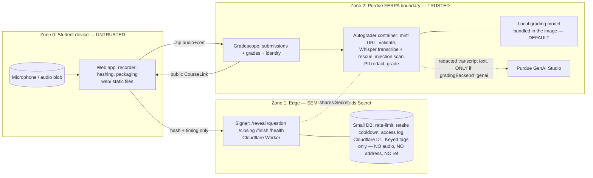

# 04 — Architecture & Trust Zones

Components, the trust boundary each sits behind, and the deployment topology.
Zones matter because **INV-SEC-4 / INV-PRIV-1** are about what crosses which boundary.

## Components & zones

## Boundary rules (what may cross)
- **Z0 → Z1**: only `{opaque studentRef, token, audioSHA256, timings}`. **Never audio** (INV-PRIV-1),
  and **never a plaintext email** — the ref is HMAC'd in the browser (INV-PRIV-2).
- **Z0 → Z2**: the `.zip` (audio + certificate) — audio's only destination is Gradescope.
- **Z1 internal**: Signer ↔ DB stores counters, timestamps, and **keyed tags** —
  `HMAC(Secret, value)`, never a raw value and never a plain digest (INV-PRIV-5). A plain hash of a
  32-bit address or a 30-bit student id is invertible by enumeration, so "we store only a hash"
  protected nothing against the one party it was written for: someone holding a dump of the
  database. Every table has a swept retention bound (`rl` 60 s, `attempt` 1 day, `access_log`
  7 days).
- **Z2 → GenAI**: the only outbound flow, and **in the default configuration it does not happen at
  all.** `gradingBackend` defaults to `local`: a small open-weights model bundled in the autograder
  image grades the transcript inside Z2, so nothing crosses. See INV-GRADE-1 for why that is the
  default despite GenAI grading better — Purdue GenAI Studio holds no FERPA certification, and
  exporting student work is the Instructor's decision to take, not ours to take on their behalf.
  - When an Instructor *does* choose `genai`, the flow carries the transcript **text** — never
    audio (INV-PRIV-3) — with recognisable personal details redacted first (INV-PRIV-4), inside a
    random per-request fence that marks it as data rather than instructions (INV-SEC-10). A
    transcript carrying a detected injection attempt does not cross at all.
  - **The two models are never resident together.** Transcription (including the rescue pass)
    finishes and `transcribe.release()` frees the speech model before the grading model loads, so
    the container's peak is `max(whisper, grader)` rather than their sum. That, plus grading one
    question per call so the context does not grow with `questionsPerAttempt`, is what fits a 4B
    grader into Gradescope's 6 GB container with ~50% headroom instead of ~10%.
- **Z2 internal**: Gradescope holds the audio and the **unredacted** transcript. That is
  deliberate — it is the system of record, it is inside the FERPA boundary, and an instructor
  investigating an attempt needs the real words (and has the audio anyway).
- **Secret** lives in Z1 (Signer env) and Z2 (autograder env) only; never Z0. (INV-SEC-4)

## Deployment topology
| Piece | Where | Cost | Why |
|-------|-------|------|-----|
| Web app | Static host (Cloudflare Pages / GitHub Pages) | free | no backend needed |
| Signer | Cloudflare Worker | free (100k req/day) | edge clock, HMAC via Web Crypto, DoS absorbed at edge |
| DB | Cloudflare D1 (SQLite) | free (100k writes/day) | small: rate-limit, retake cooldown, access log. The AccessKey gate is pure crypto and needs none of it |
| Autograder | Gradescope container | included | inside FERPA boundary; runs Whisper, then the grader. **Needs 4.0 CPU / 6.0 GB** for local grading (speech ~1.7 GB then grader ~3.0 GB, sequentially). 2.0 CPU / 3.0 GB is enough only with `gradingBackend: genai` and no local model bundled |
| GenAI | Purdue GenAI Studio | Purdue-provided | on-prem, **opt-in**. No FERPA certification — see INV-GRADE-1 |
| Local grader | Bundled GGUF in the autograder image | free | the default. Nothing leaves the container; no key, no account, no outage |

Local-dev equivalents exist for every piece (Node signer, filesystem, local autograder run)
so the whole system runs with no cloud account — see [STATUS](../docs/project/STATUS.md).

## Statelessness posture
The Signer is **logically stateless**: all cross-request memory travels in signed tokens
(RevealToken carries the whole attempt). The DB is a *hardening* layer (rate-limit, optional
audit), not correctness-critical — losing it degrades DoS protection, not integrity. This
satisfies "stateless/sessionless but may have a small database."

## Key files (drift anchors)
- Signer (edge): [server/worker/signer-worker.js](../server/worker/signer-worker.js)
- Signer (local dev): [server/signer.js](../server/signer.js)
- Shared protocol: [server/lib/protocol.js](../server/lib/protocol.js)
- Web app: [web/](../web/)
- Autograder: [autograder/source/](../autograder/source/)
  — `transcribe.py` (main pass + rescue + release, INV-INTEGRITY-9), `injection.py` (INV-SEC-10),
  `pii.py` (INV-PRIV-4), `localmodel.py` + `calibration.py` (INV-GRADE-1/2/3),
  `grade.py` (backend choice, batching, rate-limit backoff)
- Grader calibration harness: [tools/eval/](../tools/eval/) + [tools/calibrate-grader.py](../tools/calibrate-grader.py)
